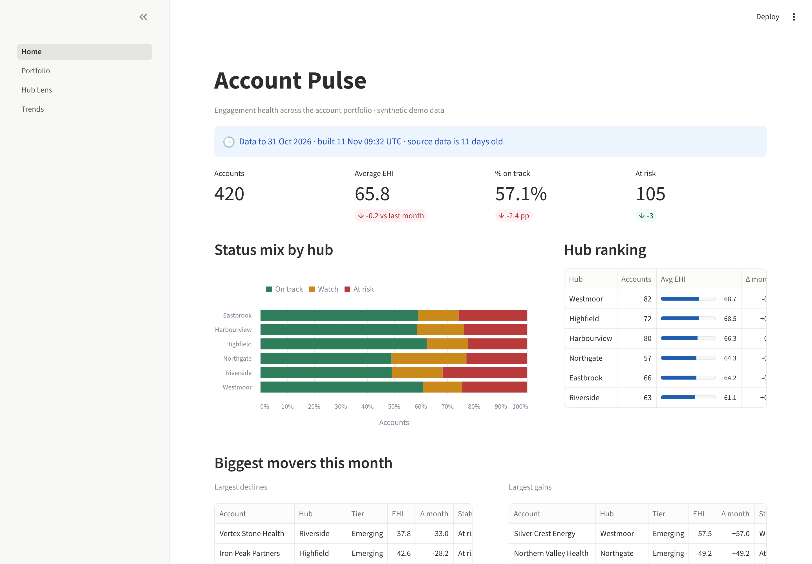
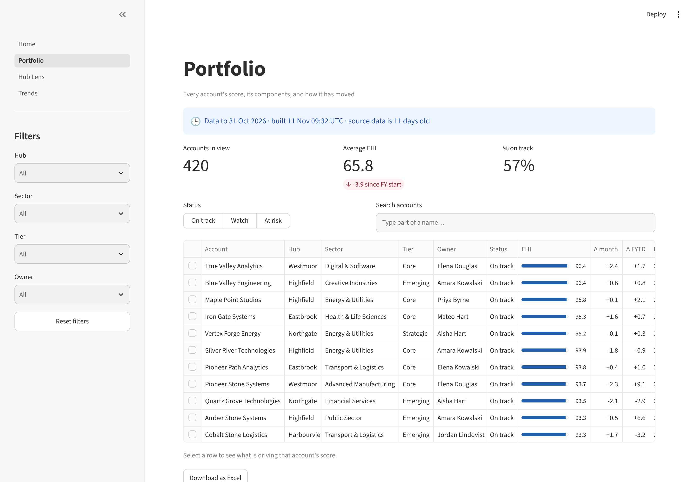
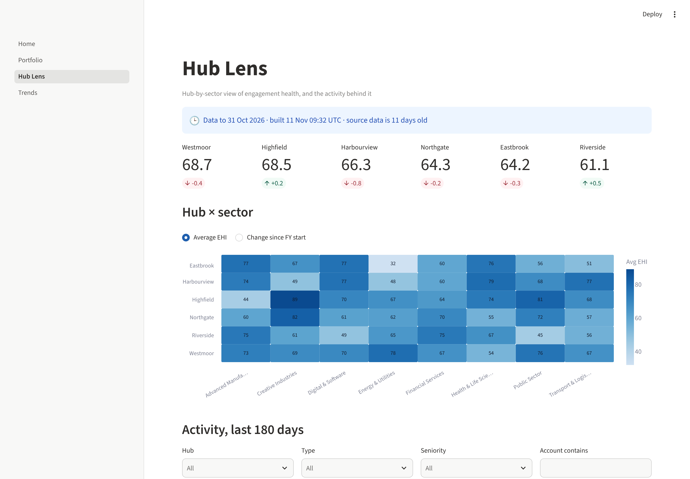
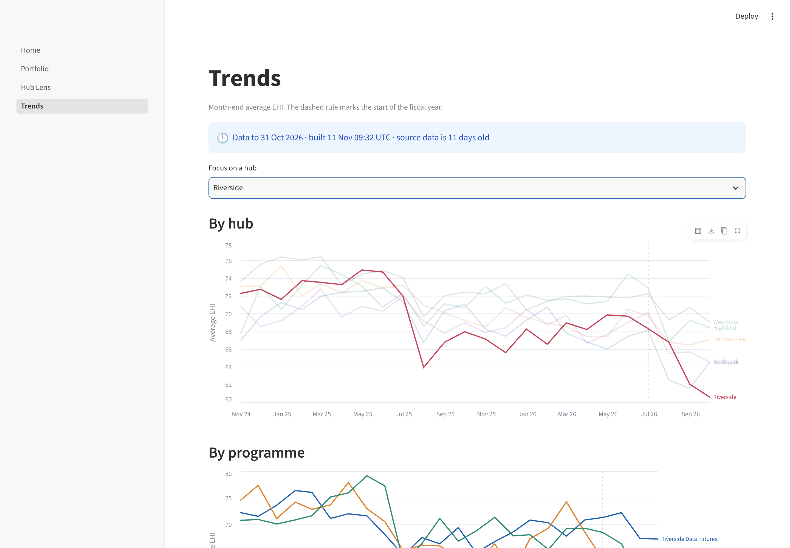
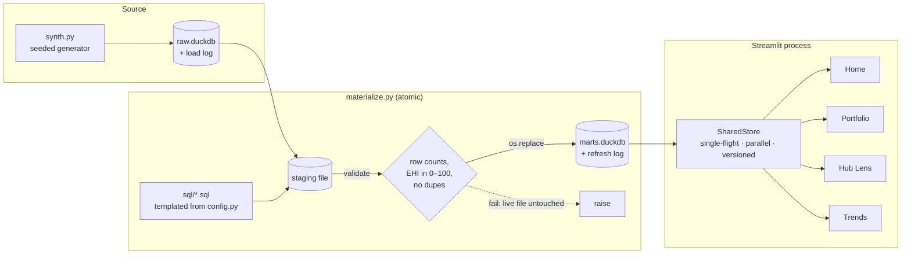

# Account Pulse

**Engagement health analytics, end to end:** a SQL materialisation layer, a
weighted scoring model, a concurrency-safe shared data layer, and a multi-page
Streamlit dashboard. It runs locally in under a minute on **fully synthetic
data**.

[](https://github.com/ameerakhan/account-pulse/actions/workflows/ci.yml)




> All hubs, sectors, programmes, accounts and people are generated by a seeded
> random process in [`pulse/synth.py`](pulse/synth.py). Nothing here is real data.

---

## What it does

An account-management team looks after ~400 client accounts across six regional
**hubs**. Every meeting, workshop, proposal or site visit is logged as an
activity. Account Pulse turns that activity log into an **Engagement Health
Index (EHI, 0–100)** per account and month. Teams can use it to see which
accounts are healthy, which are slipping, and where to act.

| Page | Answers |
|---|---|
| **Home** | How healthy is the portfolio, and who moved the most this month? |
| **Portfolio** | Every account, filterable, with a per-account component breakdown and Excel export |
| **Hub Lens** | Where is engagement strong or weak, by hub × sector, and what activity sits behind it? |
| **Trends** | How has each hub and programme moved month by month since the fiscal year started? |

<table><tr>
<td></td>
<td></td>
</tr><tr>
<td></td>
<td>

### The score

| Component | Weight | Measures |
|---|---|---|
| Recency | 25% | exp. decay since last activity |
| Frequency | 25% | last 90 days vs tier expectation |
| Breadth | 15% | distinct activity types, 180 days |
| Depth | 15% | share with senior contacts, 180 days |
| Attainment | 20% | FY-to-date vs prorated plan target |

**On track** ≥ 70 · **Watch** ≥ 50 · **At risk** < 50

</td>
</tr></table>

---

## Quick start

```bash
git clone https://github.com/ameerakhan/account-pulse && cd account-pulse
python -m venv .venv && source .venv/bin/activate
make install   # pip install -e ".[dev]"
make data      # generate ~31k synthetic activities into data/raw.duckdb
make build     # materialise marts into data/marts.duckdb (atomic)
make app       # streamlit run app/Home.py
```

`make test` runs the suite, and `make bench` runs the concurrency benchmark.

---

## Architecture



More detail in [docs/architecture.md](docs/architecture.md). The operational
guide is [docs/runbook.md](docs/runbook.md).

---

## Engineering highlights

### 1. One definition of the score, independently verified
The EHI is defined **once**, in SQL ([`sql/10_account_snapshots.sql`](sql/10_account_snapshots.sql)),
at every month-end for two years. Every other mart derives from that table.
Weights, thresholds and tier expectations live in [`pulse/config.py`](pulse/config.py)
and are injected into the SQL, so nothing is hard-coded twice.
[`pulse/scoring.py`](pulse/scoring.py) re-implements the same rules row by row
in plain Python. The test suite asserts that **SQL and Python agree for every
account** at several snapshots, including a fiscal-year boundary.

### 2. Builds that can't half-fail
`CREATE OR REPLACE` in place has a quiet failure mode. When one statement
fails, the old table survives and the dashboard shows stale numbers with no
error. Here every mart is built into a **staging file**, then **validated**
(non-empty, EHI within 0–100, one row per account, account count reconciles
to source). Only then is the staging file swapped in with an atomic
`os.replace`. Tests inject a broken SQL file and an empty mart, and assert
that the live file is byte-for-byte unchanged.

### 3. A data layer built for many concurrent users
[`pulse/warehouse.py`](pulse/warehouse.py) replaces per-session caching with one
process-wide `SharedStore`:

- **Parallel bundles.** Each page's statements run concurrently, so a cold
  load costs the slowest query, not the sum.
- **Single-flight.** When 50 people open a page in the same second, each
  statement runs once and everyone else waits on the same `Future`.
- **One shared frame.** Sessions share a single frame instead of each getting
  a deserialised copy. pandas 3 Copy-on-Write guarantees a page can't mutate
  it for anyone else, and a test proves it.
- **Versioned by file identity.** A rebuilt marts file is picked up
  automatically, so the app needs no restart after a refresh.
- **Failures are never cached.** The next caller retries.

`make bench` gives each statement a fixed 0.4 s latency, standing in for a
remote warehouse:

```
page=home  statements=4  latency=0.4s each

serial, one session                  1.65s  4 statements
parallel bundle, one session         0.41s  4 statements
50 sessions at once                  0.42s  4 statements (naive: 200)
```

Writing that benchmark also surfaced a real deadlock risk. Running a bundle on
the same pool as its own fetches can starve that pool. The fix uses separate
pools and claims statements in the caller's thread, and it is pinned by a
regression test.

### 4. Responsive UI under load
- **`st.fragment`** wraps the filterable tables, so moving one filter redraws
  one section rather than the whole page. A shim falls back gracefully on
  Streamlit versions without fragments.
- **A heartbeat line** is drawn while a load is in flight. Streamlit only
  notices a queued navigation click when the script writes an element, so a
  silent blocking load would make the sidebar feel dead.
- **Filter option lists** are derived once per data version, not on every rerun.

### 5. Honest freshness
The "data as of" banner reads the build's `refresh_log`, not a hard-coded label.
It flags when raw data has been reloaded since the last build, or when the
source is more than a week old. `python -m pulse.cli freshness` exits non-zero
in either case, so a scheduler can alert on it.

### 6. Future-proofing
`pd.to_numeric(errors="ignore")` was removed in pandas 3. [`pulse/coerce.py`](pulse/coerce.py)
reproduces its old contract explicitly: convert a column only if every
non-null value parses. CI runs on Python 3.11–3.13 with current pandas.

---

## Project layout

```
pulse/               core library (no Streamlit imports)
  config.py          scoring rules, paths, runtime knobs
  synth.py           seeded synthetic data generator
  materialize.py     staged, validated, atomic mart build
  scoring.py         pure-Python reference scorer (test oracle)
  warehouse.py       SharedStore + thread-safe DuckDB runner
  queries.py         every statement, grouped into per-page bundles
  freshness.py       refresh checks
  exports.py         Excel export with a filter-notes sheet
  coerce.py          pandas-version-safe numeric coercion
sql/                 ordered, templated mart definitions
app/                 Streamlit pages + UI components
tests/               43 tests: scoring parity, atomic builds, concurrency, UI smoke tests
scripts/bench_store.py
docs/                architecture notes, runbook, screenshots
```

## Tests

```bash
make test
```

| Area | What's checked |
|---|---|
| Scoring | SQL equals the Python reference for every account; FY edges; thresholds; weight validation |
| Build | all marts and the refresh log exist; a broken SQL file or empty mart leaves the live file untouched; a missing template parameter fails loudly |
| Data layer | parallelism; single-flight across 25 threads; no deadlock with more page loads than workers; TTL; version change; errors not cached; CoW safety; pick-up of a swapped file |
| Freshness and exports | stale and reloaded-raw detection; Excel round-trip |
| UI | every page renders headlessly via `streamlit.testing`; filters work |

## Licence

MIT
